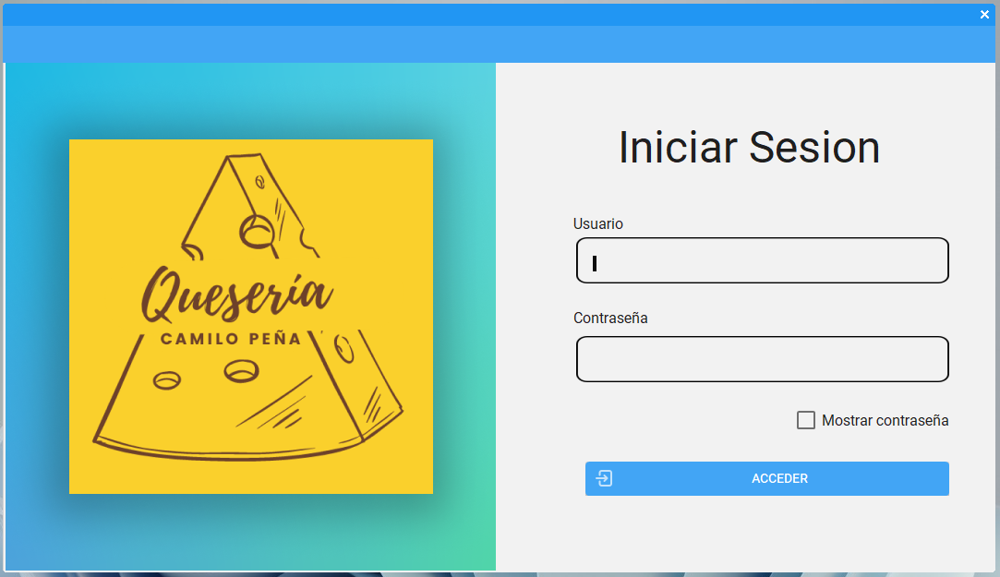
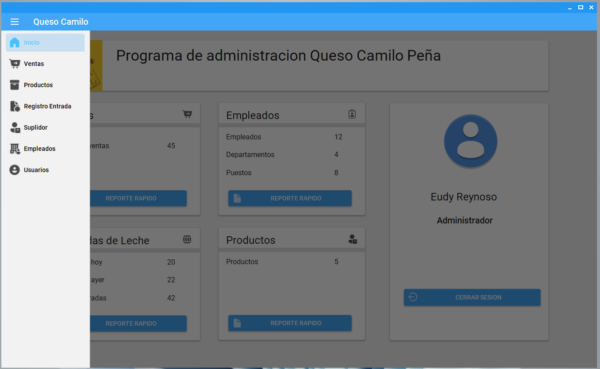
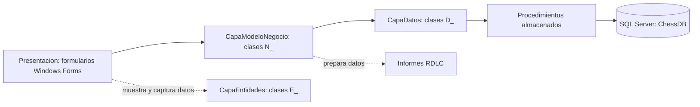

# ChessBusinnes

**Sistema de escritorio para la administración de una empresa productora de queso.** Registra empleados, suplidores, entradas de leche, productos, usuarios y ventas en Microsoft SQL Server.

> El nombre `ChessBusinnes` se conserva tal como aparece en la solución y el repositorio.

## Contenido

- [Funciones](#funciones)
- [Capturas](#capturas)
- [Tecnologías](#tecnologías)
- [Estructura del repositorio](#estructura-del-repositorio)
- [Requisitos](#requisitos)
- [Preparación y ejecución](#preparación-y-ejecución)
- [Arquitectura de la aplicación](#arquitectura-de-la-aplicación)
- [Patrones y enfoques de diseño](#patrones-y-enfoques-de-diseño)
- [Módulos y recorrido de uso](#módulos-y-recorrido-de-uso)
- [Base de datos](#base-de-datos)
- [Informes](#informes)
- [Guía para recorrer el código](#guía-para-recorrer-el-código)
- [Seguridad y limitaciones conocidas](#seguridad-y-limitaciones-conocidas)
- [Alcance de esta documentación](#alcance-de-esta-documentación)

## Funciones

- **Empleados:** registrar, consultar, buscar, editar y eliminar empleados; consultar puestos y generar reportes.
- **Suplidores:** mantener los datos de suplidores y seleccionarlos al registrar entradas de leche.
- **Entradas de leche:** registrar y consultar recepciones, buscar por suplidor, editar, eliminar y generar reportes.
- **Productos:** mantener el catálogo con descripción y precio, buscar productos y generar reportes.
- **Ventas:** crear órdenes con sus productos, consultar ventas, buscar por código y mostrar facturas o reportes.
- **Usuarios:** iniciar sesión y administrar cuentas asociadas a roles.
- **Inicio:** acceder al panel principal y a los resúmenes y reportes rápidos disponibles.

Las pestañas visibles dependen del rol asignado al usuario. Para instrucciones de uso de las pantallas, consulta el [Manual de usuario](Manual%20de%20usuario.pdf).

## Capturas

| Inicio de sesión | Pantalla principal |
| --- | --- |
|  |  |

## Tecnologías

| Área | Tecnología |
| --- | --- |
| Aplicación de escritorio | C# y Windows Forms |
| Plataforma | .NET Framework 4.7.2 |
| Base de datos | Microsoft SQL Server |
| Acceso a datos | ADO.NET y procedimientos almacenados |
| Interfaz | MaterialSkin |
| Informes | Microsoft ReportViewer y archivos RDLC |

## Estructura del repositorio

| Carpeta o archivo | Descripción |
| --- | --- |
| `Presentacion/` | Formularios Windows Forms, recursos, reportes RDLC y configuración de la aplicación. Es el proyecto de inicio. |
| `CapaModeloNegocio/` | Clases `N_*` con operaciones de negocio y preparación de datos para informes. |
| `CapaDatos/` | Clases `D_*`, conexión a SQL Server y llamadas a procedimientos almacenados. |
| `CapaEntidades/` | Clases `E_*` que transportan datos entre las capas. |
| `TestingPress/` | Proyecto Windows Forms separado; no forma parte de `ChessBusinnes.sln`. |
| `GenerarBaseDeDatos.sql` | Script de creación de la base, sus tablas y procedimientos almacenados. |
| `Manual de usuario.pdf` | Guía de uso del sistema. |
| `ChessBusinnes.sln` | Solución de Visual Studio con los cuatro proyectos principales. |

## Requisitos

- Windows y Visual Studio con el componente de desarrollo de escritorio de .NET.
- Paquete de destino de **.NET Framework 4.7.2**.
- Microsoft SQL Server. El script fija el nivel de compatibilidad 150 y contiene rutas de archivos de una instalación local de SQL Server 2019; revisa esos valores si tu instalación es diferente.
- Paquetes NuGet declarados en `Presentacion/packages.config` y `CapaDatos/packages.config`.
- Las bibliotecas `Bunifu_UI_v1.52.dll` y `Calendario.dll`. Los proyectos las referencian desde una ruta externa y no están incluidas en este repositorio; debes disponer de ellas y ajustar sus referencias en Visual Studio.

## Preparación y ejecución

1. Abre `ChessBusinnes.sln` en Visual Studio.
2. Revisa `GenerarBaseDeDatos.sql`. Ajusta las rutas locales si es necesario y ejecútalo una sola vez desde SQL Server Management Studio con permisos para crear la base de datos. El script crea `ChessDB` y no está preparado para repetirse sobre una base existente.
3. En `Presentacion/App.config`, actualiza `ConnectionStringChessDB` para que `Data Source` coincida con tu instancia. La configuración incluida usa autenticación integrada de Windows.

   ```xml
   <connectionStrings>
     <add name="ConnectionStringChessDB"
          connectionString="Data Source=TU_SERVIDOR\SQLEXPRESS;Initial Catalog=ChessDB;Integrated Security=True" />
   </connectionStrings>
   ```

4. Restaura los paquetes NuGet desde Visual Studio.
5. Actualiza las referencias a `Bunifu_UI_v1.52.dll` y `Calendario.dll` según sus ubicaciones en tu equipo.
6. Selecciona `Presentacion` como proyecto de inicio y ejecuta la solución.

La aplicación comienza en la pantalla de inicio de sesión. El script no incluye una cuenta inicial documentada para iniciar sesión; configura un usuario en la base de datos antes de usarla.

## Arquitectura de la aplicación

La solución principal organiza el trabajo en capas. El flujo habitual es:



- **`Presentacion`:** contiene `frmLogin`, `frmPrincipal`, el formulario de ventas y las ventanas de reportes. Captura datos y presenta resultados.
- **`CapaModeloNegocio`:** contiene clases como `N_Empleado` y `N_EntradaDeLeche`. La interfaz las usa para solicitar operaciones; en varios casos delegan directamente en la capa de datos.
- **`CapaDatos`:** contiene clases como `D_Empleado` y `ConexionDataBase.cs`. Gestiona la conexión y ejecuta procedimientos almacenados con parámetros.
- **`CapaEntidades`:** contiene clases como `E_Empleado`, `E_Producto` y `E_Usuario`, que agrupan datos de los registros. También define `RolesUsers` y `UserLoginChache`.

`frmPrincipal` concentra la navegación y coordina varias operaciones de interfaz, negocio y reportes. No se observa una capa independiente de controladores o presentadores.

## Patrones y enfoques de diseño

| Patrón o enfoque | Dónde aparece | Cómo se aplica aquí |
| --- | --- | --- |
| Arquitectura en capas | Los cuatro proyectos principales | La interfaz llama a negocio, negocio llama a datos y datos se comunica con SQL Server. Las entidades transportan datos entre capas. |
| Acceso a datos tipo DAO | Clases `D_*` | Cada clase encapsula operaciones de una entidad y las llamadas SQL. No hay interfaces DAO ni repositorios genéricos. |
| Capa de negocio o servicio sencilla | Clases `N_*` | Ofrece operaciones con nombres de dominio y delega varias tareas en `D_*`. La lógica de negocio es delgada en algunos módulos. |
| Entidades de datos | Clases `E_*` | Objetos con propiedades que llevan campos entre formularios, negocio y datos. No se observa una capa aparte de DTO o mapeadores. |
| Procedimientos almacenados | `GenerarBaseDeDatos.sql` y clases `D_*` | Las operaciones de persistencia se ejecutan mediante procedimientos definidos en SQL Server. |
| Singleton de biblioteca | `MaterialSkinManager.Instance` | Los formularios usan la instancia singleton provista por MaterialSkin para configurar tema y estilo. La aplicación no define su propio contenedor de servicios. |
| Estado de sesión compartido | `UserLoginChache` | Propiedades estáticas conservan el identificador, nombre, apellido y rol del usuario autenticado. Es estado global estático, no una implementación del patrón Singleton. |
| Navegación según rol | `frmPrincipal.DetectedTypeUserByRole()` | Oculta pestañas según los valores de `RolesUsers`. La comprobación observada corresponde a la interfaz. |

No se identifica una implementación explícita de **MVC, MVP, Repository, inyección de dependencias o Unit of Work**. Los formularios crean clases `N_*` y estas, a su vez, crean clases `D_*`; las dependencias apuntan directamente a implementaciones concretas.

## Módulos y recorrido de uso

1. **Inicio de sesión:** `Program.cs` abre `frmLogin`. `N_Usuario` y `D_Usuario` validan las credenciales; si son válidas, se guardan los datos del usuario en `UserLoginChache` y se abre `frmPrincipal`.
2. **Inicio:** el panel presenta accesos y resúmenes. Algunos valores están definidos en el formulario y no necesariamente representan métricas calculadas en tiempo real.
3. **Empleados:** alta, listado, búsqueda por nombre, edición y eliminación; consulta de puestos y acceso a reportes.
4. **Suplidores:** alta, listado, búsqueda, edición y eliminación. Se pueden seleccionar al registrar entradas de leche.
5. **Entradas de leche:** registro asociado a suplidor, empleado recolector, estado y fecha; consulta, búsqueda, edición, eliminación e informe.
6. **Productos:** alta, listado, búsqueda por nombre, edición y eliminación de productos con descripción y precio.
7. **Ventas:** selección de productos y registro de la orden y sus elementos; consulta, búsqueda por código, factura y reportes.
8. **Usuarios:** administración de cuentas y roles. Los nombres definidos en el código son `Administrador`, `Vendedor` y `Comprador`.

### Pestañas por rol

El método `DetectedTypeUserByRole()` aplica estas reglas de visibilidad:

| Rol | Pestañas que oculta |
| --- | --- |
| `Comprador` | Usuarios, Inicio, Empleados, Ventas y Productos |
| `Vendedor` | Usuarios, Inicio, Empleados, Entradas y Suplidores |
| `Administrador` | Muestra un aviso; este método no elimina pestañas |

Esto describe el comportamiento observado en la interfaz y no confirma que cada operación valide el rol en la base de datos.

## Base de datos

`GenerarBaseDeDatos.sql` crea `ChessDB`, sus tablas y los procedimientos almacenados que usa la aplicación.

| Tabla | Propósito según sus campos y relaciones |
| --- | --- |
| `Empleados` | Empleados, departamento, sexo y puesto. |
| `Puestos` | Catálogo de puestos de trabajo. |
| `Sexo` | Catálogo de valores de sexo. |
| `suplidor` | Datos de suplidores; el nombre está en minúsculas en el script. |
| `EntradaDeLeche` | Entradas relacionadas con suplidor, empleado y estado. |
| `EstadoDeLeche` | Catálogo de estados de las entradas. |
| `Productos` | Catálogo de productos y precios. |
| `Ordenes` | Encabezado y fecha de la orden de venta. |
| `OrdenesElemetos` | Detalle de productos y cantidades por orden; se conserva la grafía del script. |
| `Usuarios` | Cuenta de usuario y rol. |
| `Roles` | Catálogo de roles. |

El script define procedimientos para insertar, actualizar, listar, buscar y eliminar registros, además de consultas usadas por los informes. Las ventas guardan la orden y sus elementos de detalle por separado. La conexión se configura en `Presentacion/App.config` bajo `ConnectionStringChessDB`.

## Informes

Los archivos RDLC están en `Presentacion/Reports/` y se muestran con formularios de `Presentacion/Forms/FormReport/`. El proyecto incluye informes de ventas, productos, suplidores, empleados y entradas de leche, además de `Factura.rdlc`.

Las clases de `CapaModeloNegocio/ReportClass/` y `ReportVentasClass/` preparan datos para algunos informes. `CapaDatos/DataAccesReports/` contiene consultas de datos para entradas.

## Guía para recorrer el código

- **Cambiar una pantalla:** empieza en `Presentacion/Forms/` y revisa el archivo `.cs` correspondiente. Los archivos `.Designer.cs` son generados por el diseñador de Windows Forms.
- **Seguir una operación:** revisa el evento del formulario, la clase `N_*`, la clase `D_*` y el procedimiento almacenado en `GenerarBaseDeDatos.sql`.
- **Encontrar una entidad:** busca la clase correspondiente en `CapaEntidades/E_*.cs`.
- **Cambiar conexión o paquetes:** revisa `Presentacion/App.config` y los archivos `packages.config`.
- **Editar un reporte:** revisa su archivo `.rdlc` y el formulario de reporte que lo enlaza.

## Seguridad y limitaciones conocidas

- La tabla `Usuarios` define la contraseña como una columna `varchar`, y la validación compara el valor proporcionado. El código revisado no muestra almacenamiento con hash; no se recomienda usar el sistema con cuentas o información de producción hasta atenderlo.
- El script SQL contiene rutas de archivos de una instalación local y crea `ChessDB` directamente; verifica esos valores antes de ejecutarlo en otro equipo o sobre una base existente.
- Las referencias a `Bunifu_UI_v1.52.dll` y `Calendario.dll` apuntan fuera del repositorio, por lo que deben estar disponibles localmente para compilar.
- La solución principal no contiene un proyecto de pruebas automatizadas.

## Alcance de esta documentación

Este README se contrastó con la solución, los proyectos, las pantallas, la configuración de conexión y el script SQL. Describe la estructura encontrada; no afirma que la aplicación se haya compilado o probado.
